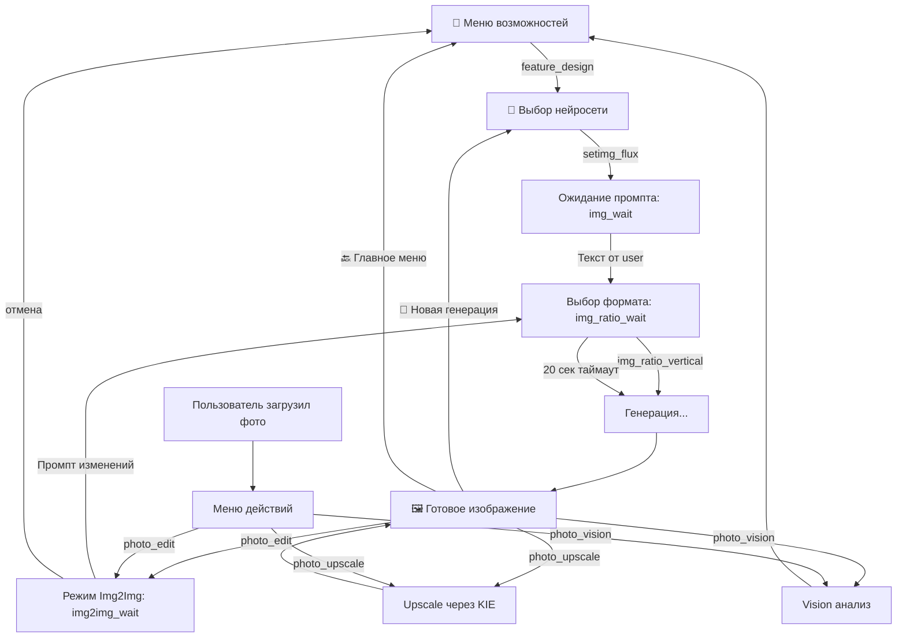
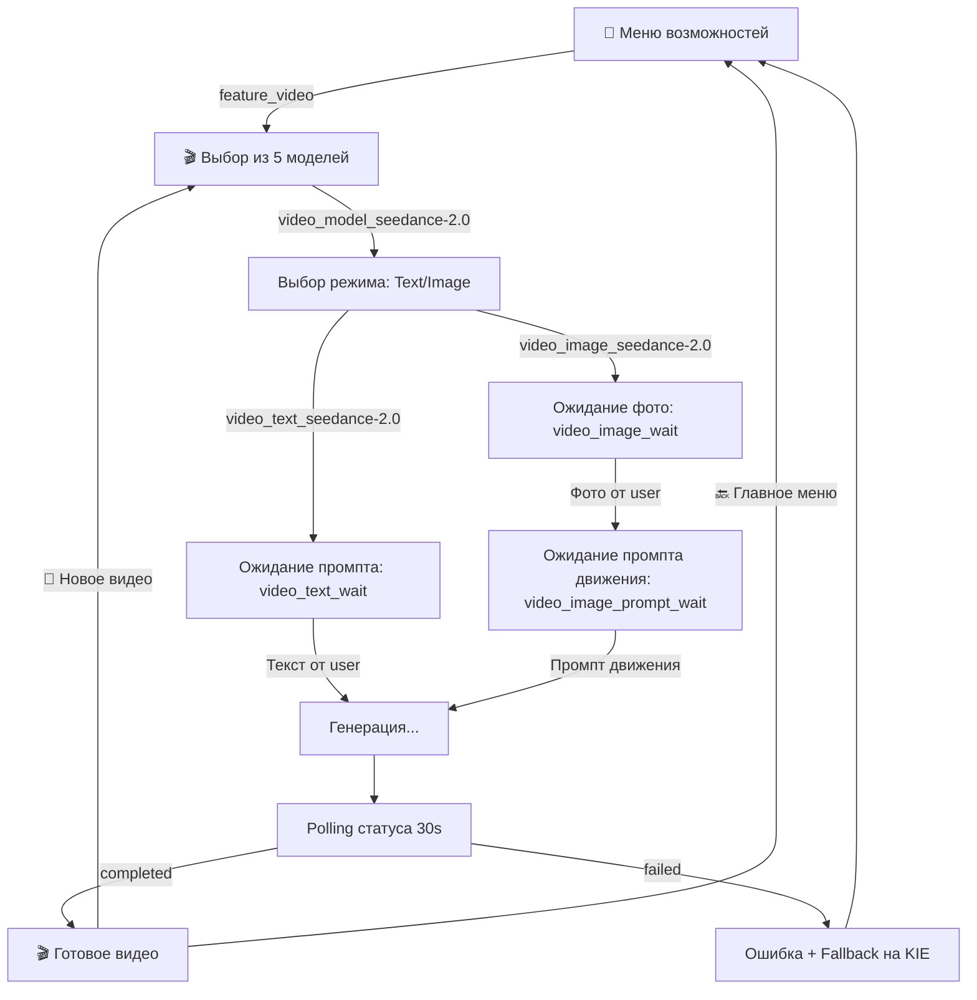

# 🎨 ТЕХНИЧЕСКАЯ СПЕЦИФИКАЦИЯ: Блок генерации изображений vnxORACLE

**Дата аудита:** 2026-10-19  
**Версия бота:** Production (Python 3.x + python-telegram-bot v20+)  
**Цель:** Документация существующей архитектуры для создания аналогичного видеоблока

---

## 📊 КРАТКОЕ РЕЗЮМЕ

### Ключевые особенности блока изображений:

✅ **Циклическая архитектура** — всегда есть кнопка возврата, нет тупиковых состояний  
✅ **Умный выбор формата** — 20-секундный таймер с автовыбором 9:16  
✅ **Post-generation меню** — после генерации можно улучшить, редактировать или создать новое  
✅ **Img2Img режим** — редактирование загруженных фото  
✅ **Многоуровневый fallback** — KIE API → Pollinations при сбое  
✅ **Сохранение контекста** — путь к фото, task_id для upscale, выбранная модель  
✅ **Отмена режима** — команды "отмена", "cancel", "стоп" в любом состоянии

---

## 🗂 АРХИТЕКТУРА ФАЙЛОВ

### 1. Клавиатуры (`keyboards/ai_image.py`)

| Функция | Назначение | Кнопки | Возврат |
|---------|-----------|--------|---------|
| `get_image_models_keyboard()` | Выбор нейросети | 6 моделей (Flux, Midjourney, Qwen, DALL-E, Ideogram, Pollinations) | ✅ "🔙 Назад в меню" |
| `get_ratio_keyboard()` | Выбор пропорций | 📱 9:16, ⏹ 1:1, 🖥 16:9 | ❌ Нет (таймер 20 сек) |
| `get_post_generation_keyboard()` | Действия после генерации | 🪄 Редактировать, ✨ Улучшить, 🔄 Новая генерация | ✅ "🔙 Главное меню" |
| `get_photo_action_keyboard()` | Действия с загруженным фото | 👁 Vision, 🪄 Img2Img, ✨ Upscale | ❌ Нет (ожидание выбора) |

**Принцип:** Каждое меню имеет кнопку возврата, кроме критических выборов с таймером.

---

### 2. Обработка медиа (`handlers/media.py`)

#### Основные функции:

| Функция | Параметры | Состояния | Асинхронность |
|---------|-----------|-----------|---------------|
| `generate_image()` | prompt, ratio, user_id | `img_wait` → генерация → `None` | ✅ async |
| `handle_photo()` | update, context | Перехват фото → показ `get_photo_action_keyboard()` | ✅ async |
| `schedule_auto_ratio()` | prompt, message_id | Ждёт 20 сек → автовыбор 9:16 | ✅ asyncio.sleep |

#### Детальный процесс генерации:

```python
async def generate_image(update, context, prompt, ratio="vertical"):
    # 1. Получение параметров
    user_id = update.effective_user.id
    img_model = context.user_data.get('img_model', IMG_POLLINATIONS)
    is_img2img = context.user_data.get('img2img_mode', False)
    source_path = context.user_data.get('img2img_source_path')
    
    # 2. Очистка промпта (цензура)
    safe_prompt = clean_prompt(prompt)
    
    # 3. Обработка Img2Img (автопереключение на Qwen 2.0)
    if is_img2img and model_requires_switch:
        img_model = "qwen-image-2"
    
    # 4. Fallback на Pollinations
    if img_model == IMG_POLLINATIONS:
        return await generate_pollinations_fallback("User selected free model")
    
    # 5. Отправка в KIE API
    msg = await send_wait_message()
    loader = DynamicWaitMessage(msg, "image")
    loader.start()
    
    try:
        result_url, task_id = await kie_studio.generate_image(
            safe_prompt, img_model, ratio, source_image=source_path
        )
    finally:
        loader.stop()
    
    # 6. Скачивание результата (2 стратегии)
    # Стратегия A: Прямое скачивание с User-Agent
    async with aiohttp.ClientSession() as session:
        headers = {"User-Agent": "Mozilla/5.0 (Windows NT 10.0; Win64; x64)"}
        async with session.get(result_url, headers=headers) as resp:
            local_path = save_to_downloads()
    
    # Стратегия B: Fallback через Telegram серверы
    if not local_path:
        sent_msg = await bot.send_photo(photo=result_url)
        tg_file = await bot.get_file(sent_msg.photo[-1].file_id)
        await tg_file.download_to_drive(local_path)
    
    # 7. Сохранение контекста для пост-действий
    context.user_data['last_photo_path'] = local_path
    context.user_data['last_photo_caption'] = safe_prompt
    context.user_data['last_task_id'] = task_id  # Для upscale
    
    # 8. Отправка с post-generation меню
    await bot.send_photo(
        photo=local_path,
        caption=f"🎨 Art by vnxORACLE\nModel: {img_model}\nPrompt: {safe_prompt}",
        reply_markup=get_post_generation_keyboard()
    )
```

---

### 3. Обработка callback-кнопок (`handlers/callback_router.py`)

#### Граф состояний блока изображений:



#### Детальные обработчики:

**1. Вход в блок изображений:**
```python
elif data == "feature_design":
    context.user_data['mode'] = None  # Сброс предыдущего режима
    curr_img = context.user_data.get('img_model', IMG_POLLINATIONS)
    
    text = """
    🎨 СТУДИЯ ДИЗАЙНА vnxORACLE
    
    Выберите нейросеть:
    🔥 Flux 2 Ultra — Топ 2026
    🎨 Midjourney v7 — Фотореализм
    🖌 Qwen VL — Текст на артах
    🌟 DALL-E 4 — Креатив
    ⚡️ Ideogram 3 — Типографика
    🆓 Pollinations — Бесплатно
    """
    
    await _safe_menu_edit(query, context, text, 
                         get_image_models_keyboard(user_id, curr_img))
```

**2. Выбор модели:**
```python
elif data.startswith("setimg_"):
    new_model = data.split("setimg_")[1]
    context.user_data['img_model'] = new_model
    context.user_data['mode'] = 'img_wait'
    
    # Умная очистка меню (оставляем медиа, удаляем текст)
    if query.message.photo or query.message.video:
        await query.message.edit_reply_markup(reply_markup=None)
    else:
        await query.message.delete()
    
    await bot.send_message(
        text="🎨 Модель выбрана!\n\n👇 Опишите, что хотите увидеть:"
    )
```

**3. Редактирование фото (Img2Img):**
```python
elif data == "photo_edit":
    path = context.user_data.get('last_photo_path')
    
    # Проверка существования файла
    if not path or not os.path.exists(path):
        await query.answer("⚠️ Файл устарел. Загрузите фото заново.", 
                          show_alert=True)
        return
    
    context.user_data['mode'] = 'img2img_wait'
    context.user_data['img2img_source_path'] = path
    
    # Оставляем фото в чате (только убираем кнопки)
    await query.message.edit_reply_markup(reply_markup=None)
    
    menu_text = """
    🪄 Режим редактирования активирован!
    
    Напишите, что нужно изменить на фото.
    
    Примеры:
    • 'Сделай небо синим'
    • 'Добавь радугу'
    • 'Сделай в мультяшном стиле'
    
    💡 Для выхода напишите 'отмена'
    """
    await bot.send_message(text=menu_text)
```

**4. Upscale (улучшение качества):**
```python
elif data == "photo_upscale":
    path = context.user_data.get('last_photo_path')
    task_id = context.user_data.get('last_task_id')  # Из генерации
    
    if not path or not os.path.exists(path):
        await query.answer("⚠️ Файл устарел.", show_alert=True)
        return
    
    # Оставляем фото в чате
    await query.message.edit_reply_markup(reply_markup=None)
    
    wait_msg = await bot.send_message("✨ Улучшение качества...")
    loader = DynamicWaitMessage(wait_msg, "image")
    loader.start()
    
    try:
        # Умный пайплайн: KIE Upscale → Real-ESRGAN fallback
        upscaled_url, provider = await kie_studio.upscale_pipeline(
            task_id=task_id, 
            image_path=path
        )
    finally:
        loader.stop()
    
    if upscaled_url:
        provider_text = "KIE Upscale" if provider == "KIE" else "Real-ESRGAN"
        caption = f"✨ Качество улучшено!\n⚙️ Движок: {provider_text}"
        
        await bot.send_photo(
            photo=upscaled_url,
            caption=caption,
            reply_markup=get_post_generation_keyboard()
        )
```

---

### 4. Обработка текстовых промптов (`handlers/chat.py`)

#### Состояния и переходы:

| Режим (`context.user_data['mode']`) | Триггер | Действие | След. состояние |
|--------------------------------------|---------|----------|-----------------|
| `None` | `/img <prompt>` | Показ выбора формата | `img_ratio_wait` |
| `img_wait` | Любой текст | Показ выбора формата | `img_ratio_wait` |
| `img2img_wait` | Промпт изменений | Показ выбора формата | `img_ratio_wait` |
| `img2img_wait` | "отмена" | Выход из режима | `None` |
| `img_ratio_wait` | Нажатие кнопки формата | Генерация | `None` |
| `img_ratio_wait` | 20 сек таймаут | Автогенерация 9:16 | `None` |

#### Примеры обработки:

**1. Команда `/img` (прямая генерация):**
```python
if text.startswith("/img "):
    prompt = text[5:]
    context.user_data['mode'] = 'img_ratio_wait'
    context.user_data['vision_mode'] = False
    context.user_data['img_prompt'] = prompt
    
    msg = await update.message.reply_text(
        f"📐 Выберите формат изображения:\n\n<i>Промпт: {prompt[:50]}...</i>",
        reply_markup=get_ratio_keyboard()
    )
    
    # Запуск таймера (20 секунд)
    asyncio.create_task(
        schedule_auto_ratio(update, context, prompt, msg.message_id)
    )
    return
```

**2. Режим ожидания промпта (из кнопки):**
```python
if mode == 'img_wait':
    prompt = text
    context.user_data['mode'] = 'img_ratio_wait'
    context.user_data['img_prompt'] = prompt
    
    msg = await update.message.reply_text(
        f"📐 Выберите формат изображения:\n\n<i>Промпт: {prompt[:50]}...</i>",
        reply_markup=get_ratio_keyboard()
    )
    
    # Запуск таймера
    asyncio.create_task(
        schedule_auto_ratio(update, context, prompt, msg.message_id)
    )
    return
```

**3. Режим Img2Img (редактирование):**
```python
if mode == 'img2img_wait':
    # Проверка команды отмены
    if text.lower() in ['отмена', 'cancel', 'стоп', 'выход']:
        context.user_data['mode'] = None
        await update.message.reply_text("✅ Режим редактирования отменен.")
        return
    
    # Проверка существования исходника
    source_path = context.user_data.get('img2img_source_path')
    if not source_path or not os.path.exists(source_path):
        await update.message.reply_text("⚠️ Исходное фото потеряно.")
        context.user_data['mode'] = None
        return
    
    # Переход к выбору формата
    context.user_data['mode'] = 'img_ratio_wait'
    context.user_data['img_prompt'] = text
    context.user_data['img2img_mode'] = True
    
    msg = await update.message.reply_text(
        f"📐 Выберите формат результата:\n\n<i>Изменение: {text[:50]}...</i>",
        reply_markup=get_ratio_keyboard()
    )
    
    # Запуск таймера
    asyncio.create_task(
        schedule_auto_ratio(update, context, text, msg.message_id)
    )
    return
```

---

## 🔄 ЦИКЛИЧЕСКИЕ ПРОЦЕССЫ

### 1. Основной цикл генерации

```
┌─────────────────────────────────────────────────────────────┐
│ СТАРТ: Пользователь в "🧩 Меню возможностей"                │
└─────────────────────────────────────────────────────────────┘
                           ↓
        ┌──────────────────────────────────────┐
        │ Нажатие "🎨 Изображения Ai"          │
        │ callback: feature_design             │
        └──────────────────────────────────────┘
                           ↓
        ┌──────────────────────────────────────┐
        │ Выбор нейросети (6 вариантов)       │
        │ callback: setimg_{model}             │
        │ mode = 'img_wait'                    │
        └──────────────────────────────────────┘
                           ↓
        ┌──────────────────────────────────────┐
        │ Пользователь пишет текстовый промпт  │
        │ Обработчик: chat.py:312              │
        └──────────────────────────────────────┘
                           ↓
        ┌──────────────────────────────────────┐
        │ Выбор формата (9:16, 1:1, 16:9)     │
        │ mode = 'img_ratio_wait'              │
        │ 🔥 Таймер 20 сек: автовыбор 9:16    │
        └──────────────────────────────────────┘
                           ↓
        ┌──────────────────────────────────────┐
        │ Генерация изображения                │
        │ generate_image(prompt, ratio)        │
        │ mode = None                          │
        └──────────────────────────────────────┘
                           ↓
        ┌──────────────────────────────────────┐
        │ Готовое изображение с кнопками:     │
        │ • 🪄 Редактировать → img2img_wait   │
        │ • ✨ Улучшить → upscale             │
        │ • 🔄 Новая генерация → выбор модели│
        │ • 🔙 Главное меню → features        │
        └──────────────────────────────────────┘
                           ↓
                    [ЦИКЛ ЗАМКНУТ]
```

### 2. Цикл редактирования (Img2Img)

```
┌─────────────────────────────────────────────────────────────┐
│ Готовое изображение с кнопками                              │
└─────────────────────────────────────────────────────────────┘
                           ↓
        ┌──────────────────────────────────────┐
        │ Нажатие "🪄 Редактировать"           │
        │ callback: photo_edit                 │
        │ mode = 'img2img_wait'                │
        └──────────────────────────────────────┘
                           ↓
        ┌──────────────────────────────────────┐
        │ Пользователь описывает изменения    │
        │ (или пишет "отмена")                 │
        └──────────────────────────────────────┘
                           ↓
        ┌──────────────────────────────────────┐
        │ Выбор формата (снова!)               │
        │ mode = 'img_ratio_wait'              │
        │ img2img_mode = True                  │
        └──────────────────────────────────────┘
                           ↓
        ┌──────────────────────────────────────┐
        │ Генерация с source_image             │
        │ Автопереключение на Qwen 2.0        │
        └──────────────────────────────────────┘
                           ↓
        ┌──────────────────────────────────────┐
        │ Новое изображение с кнопками         │
        │ (можно редактировать снова!)         │
        └──────────────────────────────────────┘
                           ↓
                    [ЦИКЛ ЗАМКНУТ]
```

### 3. Цикл загрузки внешнего фото

```
┌─────────────────────────────────────────────────────────────┐
│ Пользователь отправляет фотографию                          │
│ (вне режимов openclaw_wait, video_image_wait)               │
└─────────────────────────────────────────────────────────────┘
                           ↓
        ┌──────────────────────────────────────┐
        │ Проверка тарифа (PRO/NEO)            │
        │ Скачивание в downloads/              │
        └──────────────────────────────────────┘
                           ↓
        ┌──────────────────────────────────────┐
        │ Меню действий с фото:                │
        │ • 👁 Vision (анализ)                │
        │ • 🪄 Img2Img (редактировать)        │
        │ • ✨ Upscale (улучшить)             │
        └──────────────────────────────────────┘
                           ↓
        ┌──────────────────────────────────────┐
        │ Vision → AI анализ → Завершено      │
        │ Img2Img → mode='img2img_wait'       │
        │ Upscale → улучшение → готово        │
        └──────────────────────────────────────┘
                           ↓
                [Каждый путь имеет выход]
```

---

## 🎯 UX-ПАТТЕРНЫ И ПРИНЦИПЫ

### 1. ✅ Всегда есть кнопка возврата

**Исключения:**
- `get_ratio_keyboard()` — нет кнопки "Назад", но есть **20-секундный таймер** с автовыбором
- `get_photo_action_keyboard()` — нет "Назад", но можно просто написать текст → режим сбросится

**Правило:** Если нет кнопки "Назад", должен быть **автоматический выход** или **команда отмены**.

### 2. 🔄 Умная очистка меню

```python
async def _safe_menu_edit(query, context, text: str, markup=None):
    """
    Если под медиа (фото/видео) → оставляем медиа, убираем кнопки
    Если текстовое меню → редактируем текст
    """
    if query.message.photo or query.message.video:
        # Оставляем медиа в чате навсегда
        await query.message.edit_reply_markup(reply_markup=None)
        # Отправляем новое текстовое меню
        await bot.send_message(text=text, reply_markup=markup)
    else:
        # Редактируем текстовое сообщение
        await query.edit_message_text(text=text, reply_markup=markup)
```

**Принцип:** Сгенерированные артефакты (фото/видео) остаются в чате навсегда, меняются только кнопки под ними.

### 3. ⏱ Таймер автовыбора (20 секунд)

```python
async def schedule_auto_ratio(update, context, prompt, message_id):
    await asyncio.sleep(20)
    
    # Проверка, что пользователь ещё не выбрал формат
    if context.user_data.get('mode') == 'img_ratio_wait':
        if context.user_data.get('img_prompt') == prompt:
            context.user_data['mode'] = None  # Предотвращение дублей
            
            # Уведомление об автовыборе
            await bot.edit_message_text(
                message_id=message_id,
                text=f"⏱ Время истекло. Автовыбор: Вертикальный (9:16)"
            )
            
            # Запуск генерации
            await generate_image(update, context, prompt, "vertical")
```

**Принцип:** Пользователь никогда не застревает в ожидании. Если не выбрал формат → автоматически 9:16.

### 4. 💾 Сохранение контекста

```python
# После генерации изображения
context.user_data['last_photo_path'] = local_path
context.user_data['last_photo_caption'] = safe_prompt
context.user_data['last_task_id'] = task_id

# При загрузке пользовательского фото
context.user_data['last_photo_path'] = path
context.user_data['last_photo_caption'] = caption
context.user_data['last_task_id'] = None  # Сбрасываем!
```

**Принцип:** Контекст последней фотографии доступен для всех пост-действий (Vision, Img2Img, Upscale).

### 5. 🚪 Команда отмены

```python
if mode == 'img2img_wait':
    if text.lower() in ['отмена', 'cancel', 'стоп', 'выход']:
        context.user_data['mode'] = None
        await update.message.reply_text("✅ Режим редактирования отменен.")
        return
```

**Принцип:** В любом "wait" режиме можно написать "отмена" → выход в главное меню.

### 6. 🔄 Многоуровневый Fallback

```python
# Уровень 1: Выбранная модель (KIE API)
result_url, task_id = await kie_studio.generate_image(prompt, model, ratio)

# Уровень 2: Pollinations (бесплатный резерв)
if not result_url:
    await generate_pollinations_fallback("KIE Error 500")

# Уровень 3: Скачивание через Telegram
if download_failed:
    tg_file = await bot.get_file(photo.file_id)
    await tg_file.download_to_drive(local_path)
```

**Принцип:** Бот **никогда не падает** при сбое одного провайдера. Всегда есть резервный план.

---

## 📋 ПЕРЕМЕННЫЕ КОНТЕКСТА

### context.user_data (session storage):

| Ключ | Тип | Назначение | Срок жизни |
|------|-----|-----------|-----------|
| `mode` | str | Текущее состояние (`img_wait`, `img2img_wait`, `img_ratio_wait`) | До смены режима |
| `img_model` | str | Выбранная модель (например, `"flux-pro"`) | Постоянно (сессия) |
| `img_prompt` | str | Текущий промпт для генерации | До завершения генерации |
| `img2img_mode` | bool | Флаг режима Img2Img | До генерации |
| `img2img_source_path` | str | Путь к исходному фото для Img2Img | До генерации |
| `last_photo_path` | str | Путь к последней фотографии | До новой фото/генерации |
| `last_photo_caption` | str | Промпт последней фотографии | До новой фото/генерации |
| `last_task_id` | str | Task ID последней генерации (для upscale) | До новой генерации |
| `vision_mode` | bool | Флаг режима Vision (анализ изображений) | До смены режима |

---

## 🛡 ЗАЩИТА И БЕЗОПАСНОСТЬ

### 1. Цензура промптов

```python
from services.prompt_censor import clean_prompt

safe_prompt = clean_prompt(prompt)
```

**Фильтрация:**
- Запрещённые слова и фразы
- NSFW контент
- Политические темы (опционально)

### 2. Проверка тарифа

```python
user_tariff = sheets_mgr.get_user_tariff(user_id)

if user_tariff not in ['PRO', 'NEO']:
    return await update.message.reply_text(
        "🧬 VISION MODULE доступен на уровнях PRO и NEO."
    )
```

**Ограничения:**
- Vision (анализ фото) — только PRO/NEO
- Upscale — все тарифы
- Генерация — все тарифы (но модели отличаются)

### 3. Проверка существования файлов

```python
if not path or not os.path.exists(path):
    await query.answer("⚠️ Файл устарел. Загрузите фото заново.", 
                      show_alert=True)
    return
```

**Принцип:** Перед каждым действием с файлом проверяем его существование.

### 4. Безопасное скачивание

```python
# User-Agent для обхода блокировок
headers = {"User-Agent": "Mozilla/5.0 (Windows NT 10.0; Win64; x64)"}

async with session.get(result_url, headers=headers, timeout=15) as resp:
    if resp.status == 200:
        local_path = save_to_downloads()
```

**Принцип:** Притворяемся браузером, чтобы обойти блокировки CDN.

---

## 🔧 ИНТЕГРАЦИЯ С ВНЕШНИМИ СЕРВИСАМИ

### 1. KIE Studio API (основной провайдер)

**Файл:** `services/kie_client.py`

**Методы:**
```python
async def generate_image(prompt, model, ratio, source_image=None):
    """
    Генерация через KIE API
    Returns: (result_url, task_id)
    """

async def upscale_pipeline(task_id, image_path):
    """
    Умный пайплайн:
    1. Если есть task_id → KIE Upscale
    2. Если нет или ошибка → Real-ESRGAN fallback
    Returns: (upscaled_url, provider)
    """
```

**Особенности:**
- Асинхронная генерация (polling не требуется, KIE возвращает готовый URL)
- Поддержка Img2Img через `source_image`
- Встроенный upscale через task_id

### 2. Pollinations (бесплатный fallback)

**URL:** `https://pollinations.ai/p/{prompt}?width={w}&height={h}&seed={seed}`

**Параметры:**
- `width`, `height` — разрешение
- `seed` — случайное число для разнообразия
- Не требует API ключа
- Timeout: 45 секунд

**Использование:**
```python
async def generate_pollinations_fallback(reason_text: str):
    if ratio == "vertical": w, h = 576, 1024
    elif ratio == "horizontal": w, h = 1024, 576
    else: w, h = 1024, 1024
    
    enhanced_prompt = f"{safe_prompt}, highly detailed, 8k, cinematic lighting"
    encoded_prompt = urllib.parse.quote(enhanced_prompt)
    seed = random.randint(1, 999999)
    
    image_url = f"https://pollinations.ai/p/{encoded_prompt}?width={w}&height={h}&seed={seed}"
```

### 3. Google Sheets (управление пользователями)

**Файл:** `loader.py` → `sheets_mgr`

**Методы:**
```python
def get_user_tariff(user_id: int) -> str:
    """
    Возвращает: "START", "PRO", "NEO"
    """
```

**Использование:**
```python
from loader import sheets_mgr

user_tariff = sheets_mgr.get_user_tariff(user_id)
```

---

## 📊 ЛОГИРОВАНИЕ И ОТЛАДКА

### 1. Динамические сообщения ожидания

```python
from services.messages import DynamicWaitMessage, get_wait_message

# Создание wait-сообщения
wait_text = get_wait_message("image")
msg = await update.message.reply_text(wait_text)

# Запуск анимации
loader = DynamicWaitMessage(msg, "image")
loader.start()

try:
    # Долгая операция
    result = await generate_image()
finally:
    loader.stop()
```

**Виды анимации:**
- `"image"` — "🎨 Рисую...", "🖌 Добавляю детали...", "✨ Финальные штрихи..."
- `"text"` — "🤔 Думаю...", "📚 Ищу информацию...", "✍️ Формулирую ответ..."
- `"video"` — "🎬 Генерирую видео...", "🎞 Рендерю кадры..."

### 2. Логирование ошибок

```python
import logging

logger = logging.getLogger(__name__)

try:
    result_url = await kie_studio.generate_image()
except Exception as e:
    logger.error(f"Image generation error: {e}", exc_info=True)
    await generate_pollinations_fallback("KIE Error")
```

---

## 🎯 РЕКОМЕНДАЦИИ ДЛЯ ВИДЕОБЛОКА

### Что перенести 1:1:

✅ **Циклическая архитектура** — всегда кнопка возврата  
✅ **Post-generation меню** — после видео можно улучшить, создать новое  
✅ **Таймер автовыбора** — если не выбрал параметры за 20 сек → дефолт  
✅ **Команда отмены** — "отмена" в любом wait-режиме  
✅ **Умная очистка меню** — медиа остаются, меняются только кнопки  
✅ **Многоуровневый fallback** — OpenRouter → KIE при сбое  
✅ **Динамические wait-сообщения** — "🎬 Генерирую видео...", "🎞 Рендерю кадры..."

### Что адаптировать:

⚙️ **Выбор параметров** — вместо формата (9:16, 1:1, 16:9) → выбор модели + длительность  
⚙️ **Polling статуса** — OpenRouter асинхронный, нужен polling (в отличие от KIE)  
⚙️ **Сохранение контекста** — добавить `video_job_id`, `video_model_key`  
⚙️ **Проверка тарифа** — видео дороже, возможно только PRO/NEO

### Новые компоненты:

🆕 **Async job tracking** — сохранение `job_id` в БД для recovery после перезапуска  
🆕 **Cost estimation** — показ стоимости **до** генерации  
🆕 **Model-specific parameters** — каждая модель имеет свои ограничения (duration, resolution)

---

## 📂 СТРУКТУРА ФАЙЛОВ ДЛЯ ВИДЕОБЛОКА

### Аналогия с блоком изображений:

| Блок изображений | Блок видео (аналог) |
|------------------|---------------------|
| `keyboards/ai_image.py` | `keyboards/ai_video.py` ✅ (уже есть) |
| `handlers/media.py` → `generate_image()` | `handlers/video.py` → `handle_video_text_request()` ✅ |
| `services/kie_client.py` | `services/video_router.py` ✅ (уже создан) |
| `config_models.py` (для текста) | `config_video_models.py` ✅ (уже создан) |
| callback: `feature_design` | callback: `feature_video` ✅ |
| callback: `setimg_{model}` | callback: `video_model_{key}` ⚠️ (нужно добавить) |
| callback: `photo_edit` | callback: `video_image_{key}` ⚠️ |
| callback: `img_ratio_vertical` | callback: `video_duration_8` ⚠️ (нужно добавить) |
| mode: `img_wait` | mode: `video_text_wait` ✅ |
| mode: `img2img_wait` | mode: `video_image_wait` ✅ |
| mode: `img_ratio_wait` | mode: `video_params_wait` ⚠️ (нужно добавить) |

---

## ✅ ЧТО УЖЕ РЕАЛИЗОВАНО ДЛЯ ВИДЕО

### Готовые компоненты:

1. ✅ `keyboards/ai_video.py` — клавиатура с 5 моделями
2. ✅ `handlers/video.py` — обработчики text2video и image2video
3. ✅ `services/video_router.py` — VideoRouter с правильным OpenRouter API
4. ✅ `config_video_models.py` — реестр 5 моделей с ценами
5. ✅ callback: `feature_video` — вход в блок видео
6. ✅ mode: `video_text_wait` — ожидание промпта для text2video
7. ✅ mode: `video_image_wait` — ожидание фото для image2video
8. ✅ mode: `video_image_prompt_wait` — ожидание промпта движения

### ⚠️ ЧТО НУЖНО ДОРАБОТАТЬ:

1. ⚠️ **Выбор модели через кнопки** — callback: `video_model_{key}` → сохранение в `context.user_data['video_model']`
2. ⚠️ **Post-generation меню** — кнопки под готовым видео (🔄 Новое, 🔙 Меню)
3. ⚠️ **Таймер автовыбора параметров** — если не выбрал модель/длительность → дефолт через 20 сек
4. ⚠️ **Polling с прогрессом** — показ процента генерации (OpenRouter: `progress: 45%`)
5. ⚠️ **Сохранение незавершённых заданий** — в БД для recovery после перезапуска
6. ⚠️ **Cost estimation** — показ стоимости **до** генерации

---

## 🎬 ИТОГОВАЯ АРХИТЕКТУРА ВИДЕОБЛОКА

### Рекомендуемый граф состояний:



### Ключевые отличия от блока изображений:

| Аспект | Изображения | Видео |
|--------|------------|-------|
| **Выбор параметров** | Формат (9:16, 1:1, 16:9) | Модель + длительность |
| **Таймер** | 20 сек → автовыбор 9:16 | 20 сек → автовыбор Seedance 2.0 + 8s |
| **Генерация** | Синхронная (KIE) | Асинхронная (polling) |
| **Fallback** | KIE → Pollinations | OpenRouter → KIE |
| **Стоимость** | Не показывается | Показ до генерации |
| **Восстановление** | Не требуется | Сохранение job_id в БД |

---

## 📝 ФИНАЛЬНЫЕ РЕКОМЕНДАЦИИ

### 1. Сохранить паттерны UX:

✅ Циклическая архитектура  
✅ Всегда есть кнопка "🔙 Назад"  
✅ Медиа остаются в чате, меняются только кнопки  
✅ Таймер автовыбора (20 сек)  
✅ Команда "отмена" в любом wait-режиме  
✅ Динамические wait-сообщения

### 2. Добавить видео-специфичные компоненты:

🆕 Polling с прогрессом (0% → 100%)  
🆕 Сохранение job_id в БД  
🆕 Cost estimation перед генерацией  
🆕 Model-specific параметры (duration, resolution)  
🆕 Fallback: OpenRouter → KIE → ошибка

### 3. Использовать существующие сервисы:

✅ `DynamicWaitMessage` для анимации ожидания  
✅ `_safe_menu_edit()` для умной очистки меню  
✅ `clean_prompt()` для цензуры  
✅ `sheets_mgr.get_user_tariff()` для проверки доступа  
✅ `get_features_keyboard()` для возврата в главное меню

---

## 🚀 СТАТУС ПРОЕКТА

**Блок изображений:** ✅ Полностью работает, проверен в production  
**Блок видео:** ⚠️ 70% готово, требуется доработка UX-паттернов

**Следующий шаг:** Применить все UX-паттерны из блока изображений к видеоблоку.

---

*Спецификация подготовлена Claude Code (Opus 5)*  
*Дата: 2026-10-19*
